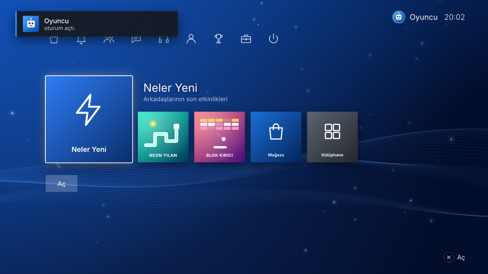
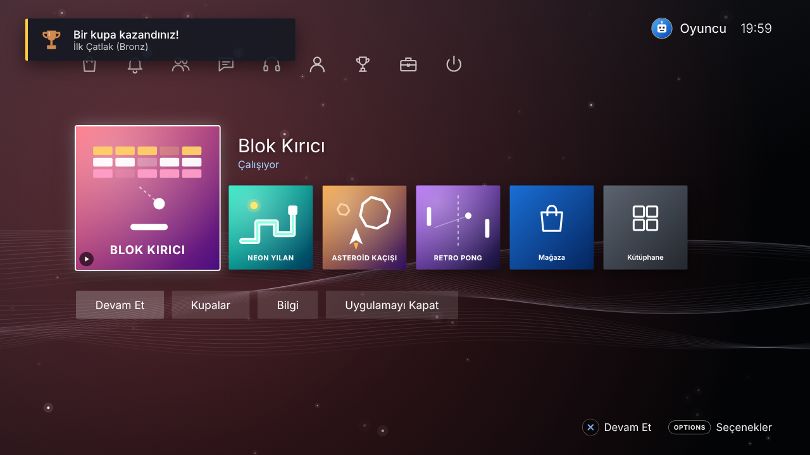
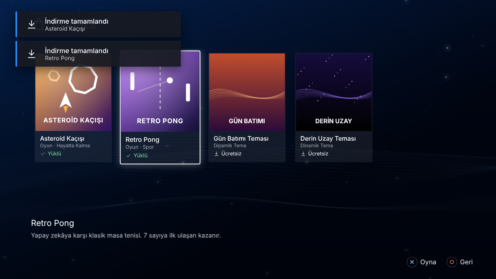
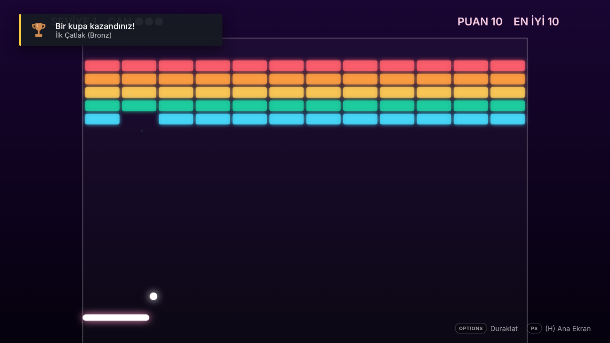

# PS4 Arayüz Emülatörü

PlayStation 4 ana ekranını (dinamik menü) masaüstünde taklit eden, **hayran yapımı** bir Electron uygulaması.
Açılış animasyonu, kullanıcı seçimi, dalgalı arka planlı ana ekran, fonksiyon menüsü, mağaza, kupalar,
bildirimler ve oynanabilir mini oyunlar içerir. Klavye ve gerçek oyun kumandası (DualShock 4 / DualSense / Xbox) ile kullanılabilir.



| Çalışan oyun askıda | Mağaza | Oyun |
|---|---|---|
|  |  |  |

## Kurulum ve çalıştırma

Gereken: [Node.js](https://nodejs.org) (LTS sürümü, 18 veya üstü).

**Windows:** `baslat.bat` dosyasına çift tıklayın (ilk açılışta paketleri kendisi kurar).

**Linux / macOS:** `./baslat.sh`

Ya da elle:

```bash
npm install
npm start                 # pencerede açar
npm run start:fullscreen  # tam ekran açar
```

### Masaüstüne kurulum dosyası (.exe) oluşturma

```bash
npm run dist:win     # Windows: dist/ içine kurulum (.exe) ve taşınabilir sürüm üretir
npm run dist:linux   # Linux: AppImage
npm run dist:mac     # macOS: dmg
```

Windows kurulumu masaüstüne ve Başlat menüsüne **"PS4 Emulator"** kısayolu ekler.

> Uygulama tarayıcıda da açılabilir: `src/index.html` dosyasını Chrome/Edge ile açmanız yeterli
> (tarayıcıda ses, ilk tuşa basıldıktan sonra başlar).

## Kontroller

| PS4 tuşu | Klavye | Kumanda |
|---|---|---|
| Yön tuşları | Ok tuşları / WASD | D-pad / sol çubuk |
| ✕ (Seç) | Enter / Boşluk | ✕ / A |
| ○ (Geri) | Esc / Backspace | ○ / B |
| △ | T | △ / Y |
| □ | F | □ / X |
| OPTIONS | M | Options / Menu |
| PS (Ana ekran) | H / Home | PS tuşu |
| Hızlı menü | Q | PS tuşuna basılı tut / Share |
| Tam ekran | F11 | – |

## Özellikler

- **Açılış sırası:** logo animasyonu ve açılış sesi → "PS tuşuna basın" → kullanıcı seçimi → oturum açma bildirimi
- **Ana ekran:** büyüyen seçili kutucuk, en son oynanan oyun başta, altında Başlat / Kupalar / Bilgi düğmeleri, seçili oyunun rengine göre tonlanan arka plan
- **Fonksiyon alanı (yukarı ok):** Mağaza, Bildirimler, Arkadaşlar, Mesajlar, Parti, Profil, Kupalar, Ayarlar, Güç
- **Dinamik arka plan:** PS4'ün klasik dalgaları ve süzülen ışık parçacıkları (canvas ile gerçek zamanlı)
- **Ortam müziği ve menü sesleri:** tamamı Web Audio API ile anında sentezlenir, ses dosyası yoktur
- **Oyun askıya alma:** oyundayken PS tuşu (H) ana ekrana döner, oyun arkada bekler; tekrar seçince kaldığı yerden devam eder
- **4 oynanabilir mini oyun:** Neon Yılan, Blok Kırıcı (yüklü gelir), Asteroid Kaçışı ve Retro Pong (Mağazadan indirilir)
- **Transformice:** kütüphanede hazır gelir; "Başlat" ile gerçek çevrimiçi oyun (transformice.com) ayrı bir pencerede açılır, girişiniz hatırlanır (internet gerekir; tarayıcı sürümünde yeni sekmede açılır)
- **Kupa sistemi:** bronz/gümüş/altın/platin kupalar, kupa kazanma bildirimi, profil seviyesi
- **Mağaza:** indirme ilerleme çubuğu, indirilen oyun ana ekrana eklenir; ek temalar (Gün Batımı, Derin Uzay)
- **Ayarlar:** tema, müzik, ses efektleri, saat biçimi, tam ekran, kontroller, sistem bilgisi, sıfırlama
- **Profil:** avatar ve çevrimiçi kimlik (kullanıcı adı) değiştirme
- **Güç:** dinlenme modu (turuncu ışık), kapatma, yeniden başlatma, oturumu kapatma
- Tüm ilerleme (kupalar, rekorlar, indirmeler, ayarlar) otomatik kaydedilir

## Proje yapısı

```
main.js / preload.js   Electron penceresi (F11 tam ekran, F12 geliştirici araçları)
src/index.html         Arayüz
src/css/style.css      Stiller (1920x1080 sahne, pencereye göre ölçeklenir)
src/js/data.js         Oyun kataloğu, temalar, kayıt sistemi
src/js/icons.js        El yapımı SVG ikonlar, kapaklar, avatarlar
src/js/audio.js        Sentezlenmiş sesler ve müzik
src/js/input.js        Klavye + Gamepad API
src/js/ui.js           Diyaloglar, bildirimler, ekran yöneticisi
src/js/home.js         Açılış, ana ekran ve tüm alt ekranlar
src/js/games.js        Mini oyunlar ve oyun çalıştırıcı
src/js/app.js          Arka plan, sistem (güç/kupa/bildirim), başlatma
```

## Yasal not

Bu proje eğitim/eğlence amaçlı bir hayran çalışmasıdır ve Sony Interactive Entertainment ile hiçbir bağlantısı yoktur.
"PlayStation" ve "PS4" ilgili sahiplerinin ticari markalarıdır. Projede Sony'ye ait hiçbir görsel, ses veya yazılım
kullanılmamıştır; tüm ikonlar, sesler ve oyunlar sıfırdan üretilmiştir. Gerçek PS4 oyunlarını çalıştırmaz.
